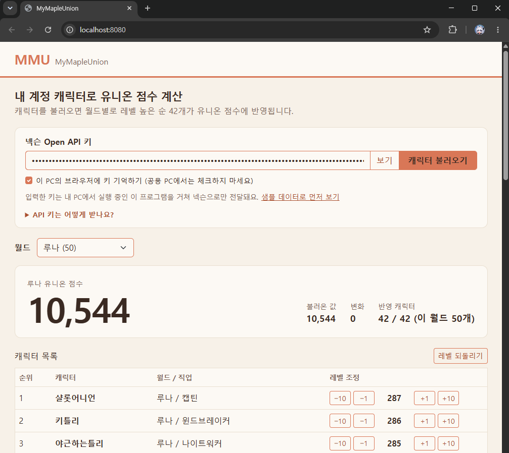

# MMU (MyMapleUnion)

메이플스토리 **유니온 점수**를 월드별로 계산하고, 캐릭터 레벨을 가상으로 올려 보며 점수 변화를 시뮬레이션하는 프로그램입니다.
넥슨 Open API로 내 계정의 캐릭터를 불러오고, 화면은 부트스트랩으로 만든 웹 화면을 내 PC에서 실행하는 방식입니다.

## 주요 기능
- 넥슨 Open API 키를 입력하면 내 계정의 모든 캐릭터를 불러옵니다
- **월드(서버)별로 나눠서** 선택한 월드의 캐릭터만 표시하고, 레벨 높은 순 상위 42개의 합으로 유니온 점수를 계산합니다
- 캐릭터별 레벨을 -10 / -1 / +1 / +10으로 가상 조정하며 점수 변화를 확인합니다
- 키 없이 화면만 보는 샘플 데이터 모드

## 스크린샷

## 사용 방법 (일반 사용자)
1. [Releases](../../releases)에서 `MyMapleUnion-windows.zip`을 내려받아 압축을 풉니다. (자바 설치 필요 없음)
2. `MyMapleUnion` 폴더 안의 `MyMapleUnion.exe`를 실행하면 브라우저가 열립니다.
3. 입력칸에 **넥슨 Open API 키**를 붙여넣고 `캐릭터 불러오기`를 누릅니다.
   - 키 받는 방법: [openapi.nexon.com](https://openapi.nexon.com) 로그인 → 마이 페이지 → 애플리케이션 등록(메이플스토리, 개발 단계) → 상세 페이지에서 API Key 복사

처음 실행할 때 Windows가 "알 수 없는 게시자" 경고를 보일 수 있습니다. 서명되지 않은 프로그램이라서 나오는 안내이며, 직접 만든 프로그램이라 `추가 정보 → 실행`을 선택하면 됩니다.

## 개발 환경
- Java 17, Spring Boot 3.3, Maven
- Bootstrap 5.3 (WebJars로 포함), 순수 JavaScript
- 넥슨 Open API (`/maplestory/v1/character/list`)
- 배포: jpackage (자바 실행 환경 포함 Windows 앱 폴더)

## 개발자용: 실행과 빌드
- 실행: 이클립스에서 `MapleUnionApplication` → `Run As > Java Application` → http://localhost:8080
- (선택) `config/local.properties`에 `nexon.api.key=키` 를 적으면 입력칸을 비워도 이 키를 사용합니다 (이 파일은 Git에 올라가지 않습니다)
- exe 만들기: 이클립스에서 `Run As > Maven build...` (Goals: `clean package`) 후 `build-exe.bat` 실행 → `dist` 폴더에 결과가 생깁니다

## 보안 안내
- API 키는 내 PC에서 실행 중인 프로그램을 거쳐 넥슨 서버로만 전달되며, 이 저장소나 서버에 저장되지 않습니다.
- 서버는 `127.0.0.1`(내 PC)에서만 접속되도록 설정되어 있습니다.

Data based on NEXON Open API
